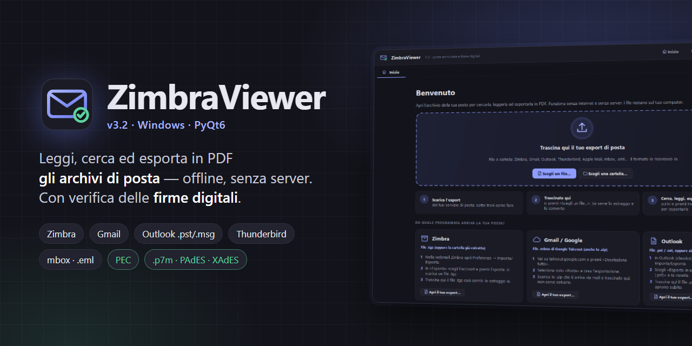
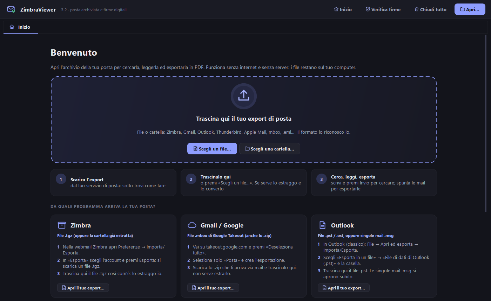

<p align="center">
  
</p>

<p align="center">
  <a href="README.md">Italiano</a> · <b>English</b>
</p>

# ZimbraViewer

**Offline mail-archive viewer with digital signature verification.**
Opens mail exports from Zimbra, Gmail, Outlook, Thunderbird, Apple Mail (or any mbox, Maildir, `.eml`), indexes them in a local database and lets you **search, read, print to PDF and export** messages with their attachments — **no server, no mail client, no internet**: your files never leave your computer.

It ships with a **digital signature** verifier (CAdES `.p7m`, PAdES, XAdES, Italian e-invoices/FatturaPA) that builds trust chains against the **Italian AgID Trusted List (eIDAS)**, and renders Italian **PEC** (certified e-mail) the way a certified mailbox does.

> The user interface is in Italian.



## Features

### Opening mail
- **Automatic format detection**: drag a file or folder onto the window, use *Apri…* (Ctrl+O / Ctrl+Shift+O), or pass paths on the command line.
- **Supported sources**
  | Source | Format |
  |---|---|
  | Zimbra | `.tgz` / `.tar.gz` / `.tar` or extracted folder |
  | Gmail (Google Takeout) | `.mbox` or `.zip` — folders rebuilt from `X-Gmail-Labels` |
  | Outlook | `.pst` / `.ost` (libpff), single `.msg` files (olefile, compressed RTF included) |
  | Thunderbird | mbox files and `.sbd` subfolders |
  | Apple Mail | `.mbox` mailboxes, `.emlx` files |
  | Generic | mbox, Maildir/Maildir++, `.eml`, `.zip` |
- Archives are **converted once** into a `Posta - <name>` folder of `.eml` files; afterwards that folder opens directly.
- mbox files are **streamed**, even multi-GB ones. Imports are queued, with progress and cancel.

### Search and reading
- **SQLite** index (`zimbra_index.db`) stored inside the mail folder with **relative paths**: move or copy the folder without re-indexing.
- Search across sender, recipient, subject, folder, body and **attachment names**; multiple words = AND, exact phrases in `<angle brackets>`.
- Selecting a folder also shows mail from **all its subfolders**.
- Sandboxed Chromium preview (no link navigation, JavaScript off) with inline (`cid:`) images.
- **Conversation history**: quoted/forwarded headers turned into readable separators (Outlook, Gmail, Zimbra, Thunderbird).
- **PEC**: banner with receipt type and certification data from `daticert.xml`; the original message inside `postacert.eml` is shown directly.

### Digital signatures (built-in P7MReader)
- **CAdES** (`.p7m`, nested or base64; detached `.p7s`), **PAdES** (signed PDFs, detects changes after signing), **XAdES** (`.xml`, cryptographic check), **FatturaPA** summary.
- Counter-signatures and RFC 3161 **timestamps** verified; expired certificates validated at signing time.
- Trust chain against the **AgID Trusted List** (refreshed at every start, with offline copy) + Windows certificate store; OCSP/CRL revocation in soft-fail mode.
- Clear outcomes: **Verified / Warning / Invalid**, with the list of checks for every signature; CSV/HTML reports.

### Export
- **Export PDF + attachments** (bulk on checked messages or a single one): for each message a folder `YYYY.MM.DD HH.mm.ss <subject>` containing the PDF, attachments (original `.p7m` **and** extracted document), a `Dettagli mail.txt` with headers and verification results, and unpacked `postacert.eml`.
- Windows-safe file names that respect the 260-character path limit.

### Interface
- Dark theme, **single-instance** window (new launches hand their paths to the open window), long jobs in **non-modal** dialogs that can be minimised to the status bar.

## Requirements

- **Windows 10/11**
- **Python 3.12+** (tested with 3.15)

| Package | Purpose | Required |
|---|---|---|
| `PyQt6`, `PyQt6-WebEngine` | UI and preview | ✅ |
| `asn1crypto`, `pyhanko`, `pyhanko-certvalidator`, `cryptography`, `lxml` | signature verification | optional |
| `olefile` | Outlook `.msg` | optional |
| `libpff-python` | Outlook `.pst` / `.ost` | optional |

Without an optional library everything else still works: signatures show as *Not verified* and `.pst` files give a clear message.

## Run from source

```bash
pip install pyqt6 pyqt6-webengine asn1crypto pyhanko pyhanko-certvalidator cryptography lxml olefile libpff-python
```

```bash
python "ZimbraViewer 3.2.py"
```

Command line (any mix of files and folders):

```bash
python "ZimbraViewer 3.2.py" "C:\Mail\export" backup.tgz takeout.zip outlook.pst mail.msg document.p7m
```

## Build the executable

`build_zimbra.bat` installs the dependencies and builds the exe with PyInstaller, including icon and version info (`version_info.txt`):

```bash
build_zimbra.bat
```

```bash
build_zimbra.bat onedir
```

The first produces a single `dist\ZimbraViewer.exe`; `onedir` produces a folder (faster start-up). The `zimbra_icon.ico` icon is generated on the first run of the `.py` if missing.

## Where data is stored

| What | Where |
|---|---|
| Mail index | `zimbra_index.db` inside the mail folder |
| AgID Trusted List | `%LOCALAPPDATA%\ZimbraViewer\TSL-IT.xml` |
| Signature settings | read (never written) from `%APPDATA%\P7MReader\impostazioni.json`, if present |
| Attachments opened on the fly | temp folder, cleaned up on exit |

## License

Released under the **GNU GPL v3.0** — see [LICENSE](LICENSE).
