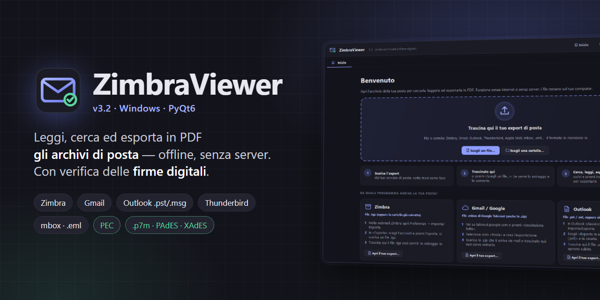
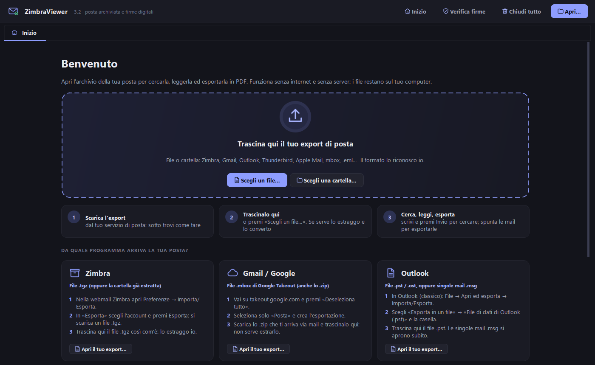

<p align="center">
  
</p>

<p align="center">
  <b>Italiano</b> · <a href="README.en.md">English</a>
</p>

# ZimbraViewer

**Lettore locale di archivi di posta con verifica delle firme digitali.**
Apre l'export della posta di Zimbra, Gmail, Outlook, Thunderbird, Apple Mail (o qualsiasi mbox, Maildir, `.eml`), lo indicizza in un database locale e permette di **cercare, leggere, stampare in PDF ed esportare** le mail con i loro allegati — **senza server, senza client di posta e senza internet**: i file restano sul tuo computer.

Integra un verificatore di **firme digitali** (CAdES `.p7m`, PAdES, XAdES, FatturaPA) con catena di fiducia verso la **Trusted List AgID (eIDAS)**, e mostra le **PEC** come in una casella certificata.



## Funzionalità

### Apertura della posta
- **Formato riconosciuto da solo**: trascina un file o una cartella sulla finestra, oppure usa *Apri…* (Ctrl+O / Ctrl+Maiusc+O) o la riga di comando.
- **Sorgenti supportate**
  | Sorgente | Formato |
  |---|---|
  | Zimbra | `.tgz` / `.tar.gz` / `.tar` o cartella estratta |
  | Gmail (Google Takeout) | `.mbox` o `.zip` — cartelle ricostruite dalle etichette `X-Gmail-Labels` |
  | Outlook | `.pst` / `.ost` (libpff), singole `.msg` (olefile, anche RTF compresso) |
  | Thunderbird | file mbox e sottocartelle `.sbd` |
  | Apple Mail | caselle `.mbox`, file `.emlx` |
  | Generico | mbox, Maildir/Maildir++, `.eml`, `.zip` |
- Gli archivi vengono **convertiti una volta sola** in una cartella `Posta - <nome>` di `.eml`; le volte successive si apre direttamente.
- mbox letti **in streaming**, anche di molti GB. Importazioni in coda, con avanzamento e annullo.

### Ricerca e lettura
- Indice **SQLite** (`zimbra_index.db`) dentro la cartella, con **percorsi relativi**: la cartella si può spostare o copiare senza re-indicizzare.
- Ricerca su mittente, destinatario, oggetto, cartella, corpo e **nomi degli allegati**; più parole = AND, frasi esatte tra `<parentesi angolari>`.
- Selezionando una cartella si vedono anche le mail di **tutte le sottocartelle**.
- Anteprima Chromium sicura (link non navigabili, JavaScript spento) con immagini incorporate (`cid:`).
- **Storico della conversazione**: intestazioni dei messaggi citati/inoltrati trasformate in separatori leggibili (Outlook, Gmail, Zimbra, Thunderbird).
- **PEC**: fascia con il tipo di ricevuta e i dati di certificazione letti da `daticert.xml`; il messaggio originale in `postacert.eml` viene mostrato direttamente.

### Firme digitali (P7MReader integrato)
- **CAdES** (`.p7m`, anche annidati o in base64; `.p7s` detached), **PAdES** (PDF firmati, con rilevamento modifiche dopo la firma), **XAdES** (`.xml`, verifica crittografica), riepilogo **FatturaPA**.
- Controfirme e **marche temporali** RFC 3161 verificate; validazione alla data di firma per i certificati scaduti.
- Catena di fiducia verso la **Trusted List AgID** (aggiornata a ogni avvio, con copia offline) + archivio certificati di Windows; revoca OCSP/CRL in soft-fail.
- Esiti chiari: **Verificato / Attenzione / Non valido**, con l'elenco dei controlli per ogni firma; report CSV/HTML.

### Esportazione
- **Esporta PDF + allegati** (massiva sulle mail spuntate o sulla singola mail): per ogni mail una cartella `AAAA.MM.GG HH.mm.ss <oggetto>` con PDF, allegati (`.p7m` originale **e** documento estratto), `Dettagli mail.txt` con intestazioni ed esiti delle verifiche, e `postacert.eml` scompattato.
- Nomi file validi per Windows e adattati al limite dei 260 caratteri.

### Interfaccia
- Tema scuro, finestra **a istanza singola** (le nuove aperture vengono passate alla finestra già aperta), lavori lunghi in finestre **non modali** riducibili nella barra di stato.

## Requisiti

- **Windows 10/11**
- **Python 3.12+** (testato con 3.15)

| Pacchetto | Uso | Obbligatorio |
|---|---|---|
| `PyQt6`, `PyQt6-WebEngine` | interfaccia e anteprima | ✅ |
| `asn1crypto`, `pyhanko`, `pyhanko-certvalidator`, `cryptography`, `lxml` | verifica firme | facoltativo |
| `olefile` | Outlook `.msg` | facoltativo |
| `libpff-python` | Outlook `.pst` / `.ost` | facoltativo |

Senza una libreria facoltativa il resto funziona: le firme risultano *Non verificato* e i `.pst` danno un messaggio chiaro.

## Avvio da sorgente

```bash
pip install pyqt6 pyqt6-webengine asn1crypto pyhanko pyhanko-certvalidator cryptography lxml olefile libpff-python
```

```bash
python "ZimbraViewer 3.2.py"
```

Riga di comando (file e cartelle in qualsiasi combinazione):

```bash
python "ZimbraViewer 3.2.py" "C:\Mail\export" backup.tgz takeout.zip outlook.pst mail.msg documento.p7m
```

## Compilare l'eseguibile

Lo script `build_zimbra.bat` installa le dipendenze e crea l'exe con PyInstaller, con icona e informazioni di versione (`version_info.txt`):

```bash
build_zimbra.bat
```

```bash
build_zimbra.bat onedir
```

Il primo crea un singolo `dist\ZimbraViewer.exe`; `onedir` crea una cartella (avvio più veloce). L'icona `zimbra_icon.ico` viene generata al primo avvio del `.py` se manca.

## Dove salva i dati

| Cosa | Dove |
|---|---|
| Indice della posta | `zimbra_index.db` dentro la cartella della posta |
| Trusted List AgID | `%LOCALAPPDATA%\ZimbraViewer\TSL-IT.xml` |
| Impostazioni firme | lette (senza modificarle) da `%APPDATA%\P7MReader\impostazioni.json`, se presente |
| Allegati aperti al volo | cartella temporanea, ripulita all'uscita |

## Licenza

Distribuito con licenza **GNU GPL v3.0** — vedi [LICENSE](LICENSE).
